# Sistema complet amb autenticació i CRUD

Aplicació web amb **Node.js**, **Express** i **EJS** per gestionar una flota de naus de Star Trek i els seus personatges. Té registre i inici de sessió amb **JWT** i dos CRUD complets (**Naus** i **Personatges**) que només poden fer servir els usuaris autenticats.

## Tecnologies

- Node.js + Express 5
- EJS (plantilles)
- `bcryptjs` (hash de contrasenyes)
- `jsonwebtoken` (JWT) + `cookie-parser`
- `method-override` (PUT i DELETE des dels formularis)
- Dades en fitxers `.json` (`db/`)

## Estructura del projecte

```
├── server.js              # Servidor, middleware JWT i rutes d'autenticació
├── config.js              # PORT, SALT_ROUNDS, SECRET_JWT_KEY
├── auth-middleware.js     # requireLogin: protegeix les rutes
├── user-repository.js     # Registre i login d'usuaris (bcrypt)
├── data.js                # Lectura/escriptura dels JSON
├── routes/                # naus.js, personatges.js, flota.js
├── views/                 # Plantilles EJS
├── public/                # CSS i JS del navegador
├── db/                    # User.json, Naus.json, Personatges.json (dades d'exemple)
├── captures/              # Captures de les proves
└── proves.http            # Proves amb REST Client
```

## Posada en marxa

```bash
npm install
npm run dev
```

El servidor arrenca a <http://localhost:5000>.

Variables opcionals (a `config.js`): `PORT`, `SALT_ROUNDS` i `SECRET_JWT_KEY` (canvia-la en producció).

## Autenticació

- `POST /register`: crea un usuari (nom mínim 3 caràcters, contrasenya mínima 6). La contrasenya es guarda encriptada amb **bcrypt**.
- `POST /login`: valida les credencials i genera un **JWT que caduca en 1 hora**.
- El token es guarda en una **cookie** `access_token` amb `httpOnly`, `sameSite: strict` i `secure` (en producció).
- Un middleware valida el token a cada petició i carrega l'usuari a `req.session.user`.
- `POST /logout`: elimina la cookie.
- `GET /protected` i `GET /profile`: pàgines només per a usuaris autenticats.
- Sense sessió, les rutes protegides responen **401**.

## Rutes

### Públiques

| Mètode | Ruta | Descripció |
| --- | --- | --- |
| GET | `/` | Pàgina d'inici amb login i registre |
| POST | `/register` | Registre d'usuari |
| POST | `/login` | Inici de sessió |
| POST | `/logout` | Tancar sessió |
| GET | `/flota`, `/flota/:id` | Llistat i detall de la flota |

### Protegides (cal estar autenticat)

| Mètode | Ruta | Descripció |
| --- | --- | --- |
| GET | `/protected` | Pàgina privada |
| GET | `/profile` | Perfil de l'usuari |
| GET | `/naus` | Llistar naus |
| GET | `/crearNau` | Formulari de creació |
| POST | `/naus` | Crear nau |
| GET | `/editNau/:id` | Formulari d'edició |
| PUT | `/naus/:id` | Actualitzar nau |
| DELETE | `/naus/:id` | Eliminar nau |
| GET | `/personatges` | Llistar personatges |
| GET | `/crearPersonatge` | Formulari de creació |
| POST | `/personatges` | Crear personatge |
| GET | `/editPersonatge/:id` | Formulari d'edició |
| PUT | `/personatges/:id` | Actualitzar personatge |
| DELETE | `/personatges/:id` | Eliminar personatge |

## Regles de negoci

- Només els usuaris autenticats poden accedir als CRUD.
- El nom i el registre d'una nau són únics; el nom d'un personatge també.
- L'estat de la nau ha de ser `En servei`, `En reparació` o `Retirada`.
- No es pot retirar ni eliminar una nau amb personatges assignats.
- Un personatge ha d'estar assignat a una nau existent i no retirada.
- Una nau no pot tenir més personatges que la seva capacitat.

## Dades d'exemple

Els fitxers `db/Naus.json`, `db/Personatges.json` i `db/User.json` contenen dades d'exemple.

## Proves

Les proves s'han fet amb **REST Client** (VS Code) usant el fitxer `proves.http`.

### 1. Registre d'usuari
#### Registre correcte
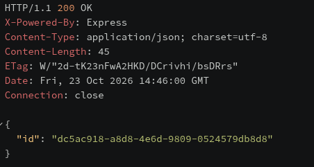

#### Registre amb usuari duplicat (400)
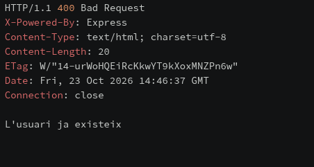

#### Registre amb dades invàlides (contrasenya curta)
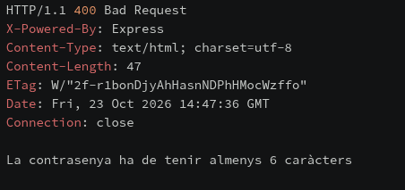

### 2. Login
#### Login incorrecte (401)
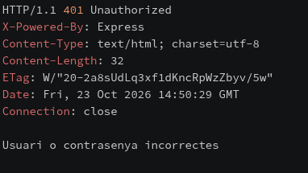

#### Login correcte i cookie access_token
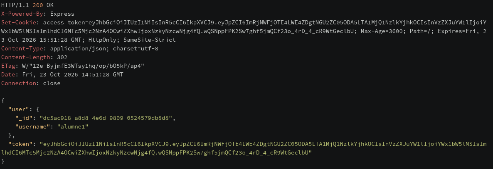

### 3. Accés a rutes protegides
#### Sense login: 401
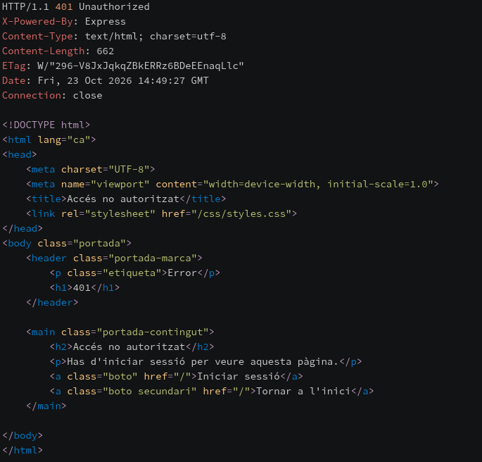

#### Amb login: 200
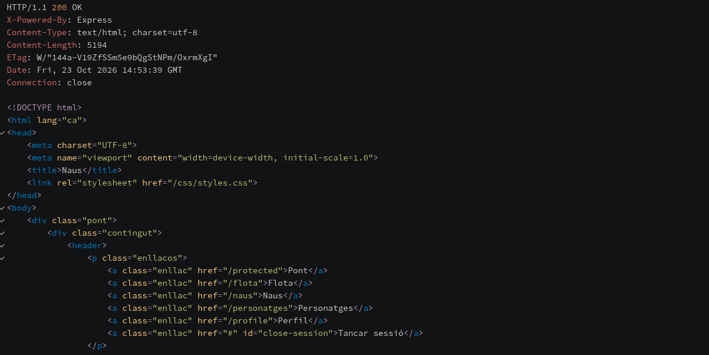

### 4. CRUD de naus
#### Crear nau (302)
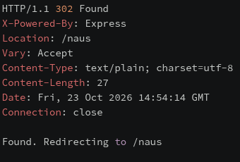

#### Crear nau duplicada (400)
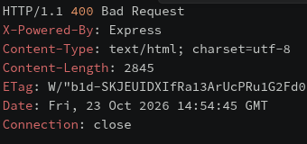

#### Editar nau
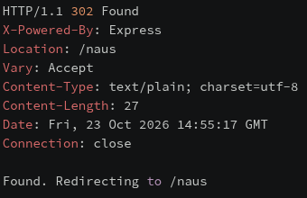

#### Eliminar nau amb personatges (409)
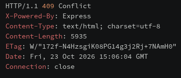

### 5. CRUD de personatges
#### Crear personatge
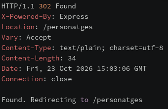

#### Personatge en nau inexistent (400)
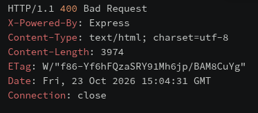

#### Editar personatge
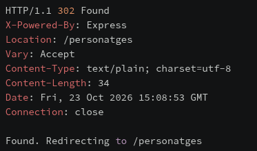

#### Eliminar personatge
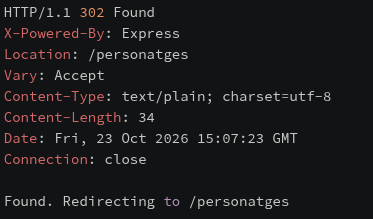

### 6. Logout

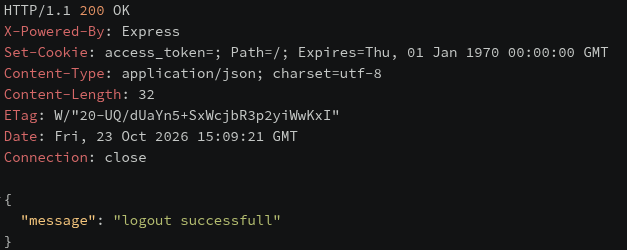

### 7. Interfície EJS

#### Pàgina d'inici
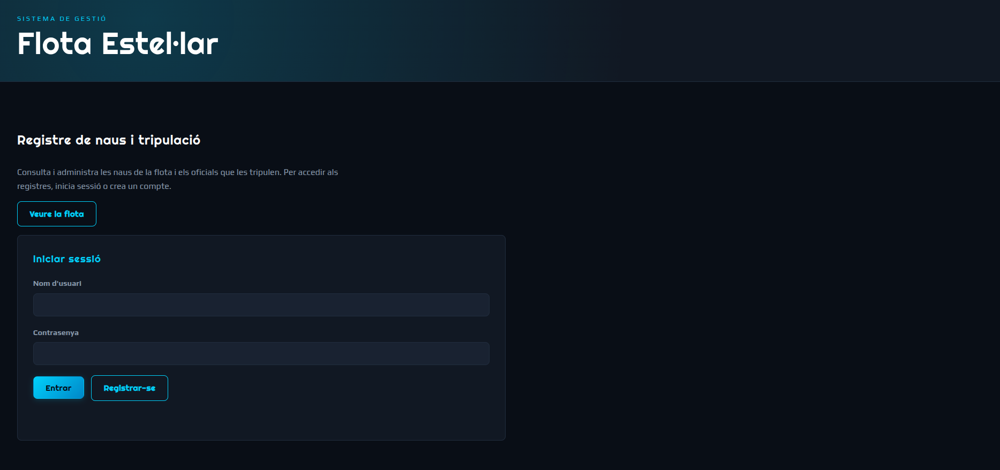

#### Pàgina protegida
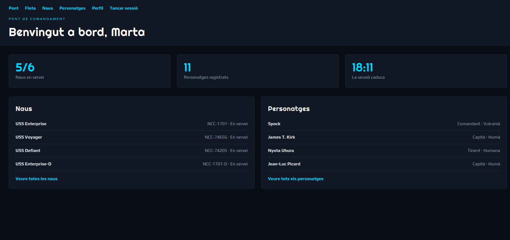

#### Perfil
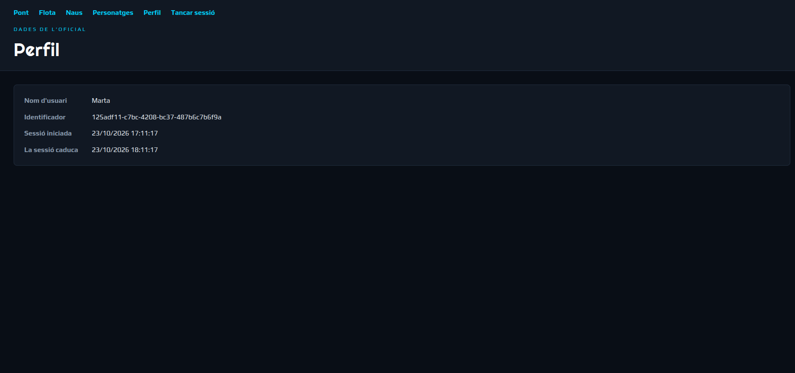